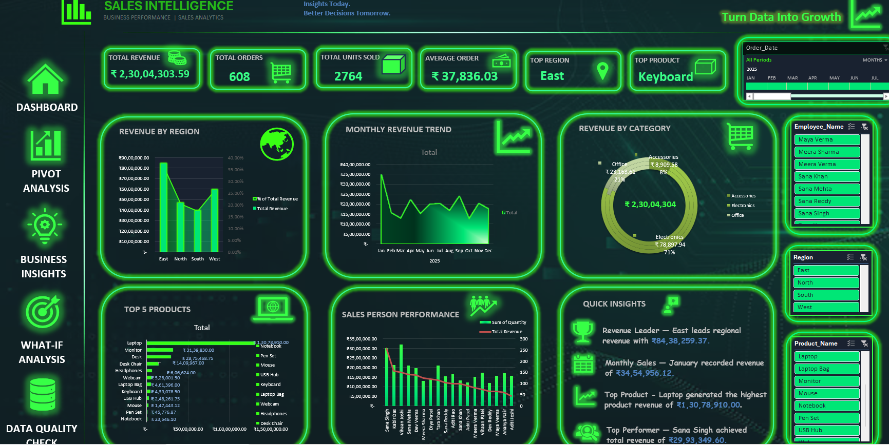

Excel Sales Analytics Project

Project Overview

This project focuses on analysing sales data using Microsoft Excel. It demonstrates data cleaning, formulas, Power Query, PivotTables, interactive dashboards, and business insights.

Tools Used

- Microsoft Excel
- Excel Formulas
- Power Query
- PivotTables
- Pivot Charts
- Slicers
- What-If Analysis
- Goal Seek

Project Features

1. Data Preparation

Organised and cleaned sales data and reviewed data quality.

2. Formula Practice

Practised statistical, logical, criteria-based, and error-handling functions along with relative, absolute, and mixed references.

3. Power Query

Used Power Query concepts for data cleaning and transformation.

4. Pivot Analysis

Created seven PivotTables to analyse sales from different perspectives.

5. Interactive Dashboard

Designed the dashboard template directly in Microsoft Excel without using ready-made internet templates.

Dashboard features:

- KPI cards
- Interactive charts
- Slicers
- Navigation buttons
- Back to Dashboard buttons

6. What-If Analysis

Explored different sales scenarios and used Goal Seek to identify the input required to achieve a target.

7. Business Insights

Summarised important findings from the sales data to understand business performance.

8. Data Quality Check

Included a section to review data quality and identify potential issues.

Repository Contents

- Excel Sales Analytics Workbook
- PowerPoint Project Presentation
- Dashboard Screenshots

Learning Outcomes

This project helped develop practical skills in Excel data preparation, formulas, data analysis, dashboard design, and business reporting.

Conclusion

The project demonstrates how Microsoft Excel can transform sales data into meaningful information and support business decision-making.

---

Project: Excel Sales Analytics Mini Project
Created using: Microsoft Excel

## Dashboard Preview

